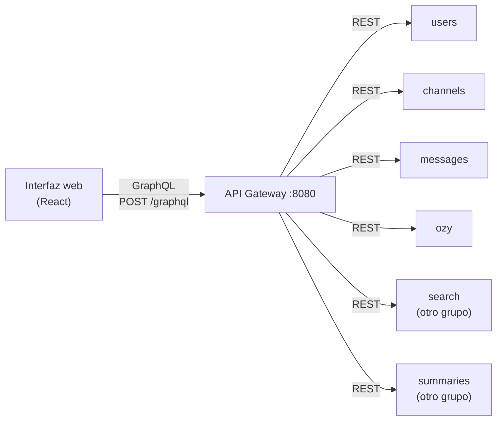

# API Gateway (GraphQL)

Único punto de entrada de la interfaz web. Expone una **API GraphQL** con queries y
mutaciones sobre todos los servicios del chat, y por dentro llama a cada
microservicio por su API REST pública.

| | |
|---|---|
| Puerto | `8080` (en el contenedor, `8000`) |
| Stack | Python 3.12 · FastAPI · [Strawberry GraphQL](https://strawberry.rocks) · httpx |
| GraphQL | `POST http://localhost:8080/graphql` |
| GraphiQL (editor web) | <http://localhost:8080/graphql> abierto en el navegador |
| Esquema | En GraphiQL, botón *Docs*; o el código en [`app/schema.py`](app/schema.py) |



## Operaciones

### Queries

| Query | Servicio | Qué devuelve |
|---|---|---|
| `health` | todos | Estado de cada servicio (`ok`, `fail`, `down`) |
| `user(id)` | users | Un usuario |
| `channels` / `channel(id)` | channels | Canales |
| `messages(channelId)` | messages + users | Mensajes en orden cronológico, con `authorName` |
| `translation(messageId, audienceLevel)` | ozy + users | Explicación guardada, con el autor |
| `glossary(ambito, estado)` | ozy | Entradas del glosario, con filtros opcionales |
| `term(term)` | ozy | Todas las entradas de un término (ej. PR tiene 3 ámbitos) |
| `searchMessages(...)` | search + users + channels | Mensajes encontrados, con nombres de autor y canal. Filtros: `content`, `channelId`, `authorIds`, `mentions`, `has`, `minDate`/`maxDate`, `sortBy`, `sortOrder`, `limit` (máx. 25), `offset` |
| `summaries(channelId)` / `latestSummary` / `summary(id)` | summaries | Resúmenes del canal |

Los tipos se pueden anidar: `Channel.messages`, `Message.author` y
`Message.translation` resuelven contra el servicio correspondiente, así que una sola
query puede combinar channels, messages, users y Ozy.

### Mutaciones

| Mutación | Servicio | Efecto |
|---|---|---|
| `createUser(displayName)` | users | Crea un usuario |
| `createChannel(name)` | channels | Crea un canal |
| `sendMessage(channelId, authorId, content)` | messages | Publica un mensaje (emite `chat.message.created`) |
| `translateMessage(messageId, audienceLevel, channelId)` | ozy | Genera la explicación en simple |
| `validateGlossaryEntry(entryId, estado, validatedBy, definition, ambito)` | ozy | Valida o rechaza una definición |
| `requestSummary(channelId, userId, timeInterval)` | summaries | Pide un resumen (asíncrono) |

Los enums del esquema (`AudienceLevel`, `Ambito`, `Estado`, `Decision`, `HasFilter`,
`SortBy`, `SortOrder`) validan los valores **antes** de llamar a los servicios.

## Ejemplos para GraphiQL

**1. Crear usuario y canal** (dos mutaciones en una operación):

```graphql
mutation {
  createUser(displayName: "Ana") { id displayName }
  createChannel(name: "equipo") { id name }
}
```

**2. Enviar un mensaje con jerga** (usa los ids del paso anterior):

```graphql
mutation {
  sendMessage(channelId: "<id del canal>", authorId: "<id de Ana>",
              content: "Hice el PR pero el pipeline falló; revisen el KPI del ETL") {
    id authorName createdAt
  }
}
```

**3. Pedir la explicación a Ozy:**

```graphql
mutation {
  translateMessage(messageId: "<id del mensaje>", audienceLevel: basico) {
    explanation
    terms { term known ambiguous meanings { ambito definition } }
  }
}
```

**4. Una query que combina 4 servicios** (channels → messages → users y Ozy):

```graphql
{
  channel(id: "<id del canal>") {
    name
    messages {
      content
      author { displayName }
      translation(audienceLevel: basico) { terms { term ambiguous } }
    }
  }
}
```

**5. Glosario:**

```graphql
{
  term(term: "PR") { ambiguous entries { ambito definition estado } }
  glossary(estado: candidato) { id term }
}
```

**6. Validar el candidato ETL:**

```graphql
mutation {
  validateGlossaryEntry(entryId: "<id de ETL>", estado: validado, validatedBy: "<id de Ana>",
                        ambito: datos, definition: "Proceso que extrae, transforma y carga datos.") {
    term estado ambito validatedBy
  }
}
```

**7. Estado de los servicios:**

```graphql
{ health { service status } }
```

## Errores

Si un servicio responde con error, GraphQL devuelve `errors` con el mismo código
HTTP en `extensions`, así la interfaz puede distinguir, por ejemplo, un 404:

```json
{
  "data": null,
  "errors": [{
    "message": "Message not found",
    "path": ["translateMessage"],
    "extensions": { "code": "NOT_FOUND", "status": 404 }
  }]
}
```

| `code` | `status` | Cuándo |
|---|---|---|
| `NOT_FOUND` | 404 | El recurso no existe en el servicio |
| `CONFLICT` | 409 | Conflicto en el servicio (ej. ámbito ya definido en el glosario) |
| `VALIDATION_ERROR` | 422 | El servicio rechazó los datos |
| `SERVICE_UNAVAILABLE` | 503 | El servicio no responde |

Un valor inválido para un enum (ej. `audienceLevel: avanzado`) lo rechaza GraphQL
antes de llamar a cualquier servicio.

La búsqueda es un caso especial: mientras el servicio construye su índice responde
`ready: false` y `retryAfter` (segundos) en vez de un error.

## Servicios de otros grupos

El gateway integra dos capacidades de otros grupos, usando sus imágenes públicas y
sus APIs tal cual (se revisó su código para que el esquema GraphQL calce con sus
contratos):

| Servicio | Repositorio | Operaciones GraphQL |
|---|---|---|
| Búsqueda (Elasticsearch) | [Mochytk/…/Tarea_Unidad_5_Despliegue](https://github.com/Mochytk/INF326-Arquitectura-de-Software_Tareas/tree/main/Tarea_Unidad_5_Despliegue) | `searchMessages` |
| Resúmenes (LLM) | [marcel-silva27/summaries-service](https://github.com/marcel-silva27/summaries-service) | `requestSummary`, `summary`, `summaries`, `latestSummary` |

## API REST (compatibilidad)

La versión anterior del gateway era REST y se mantiene en `/api/...` (por ejemplo
`GET /api/channels/{id}/messages`). La interfaz ya no la usa. GraphQL y REST
comparten el mismo código de acceso a los servicios ([`app/services.py`](app/services.py)).

## Estructura

```
gateway/
├── app/
│   ├── main.py       # FastAPI: monta /graphql (GraphiQL) y la API REST
│   ├── schema.py     # esquema GraphQL: tipos, queries y mutaciones
│   └── services.py   # llamadas a los microservicios, caché de nombres, errores
└── tests/            # pytest: servicios simulados con respx (23 tests)
```

## Tests

No necesitan Docker: los microservicios se simulan con
[respx](https://lundberg.github.io/respx/), que intercepta las llamadas httpx.

```bash
cd gateway
python -m venv .venv
.venv/Scripts/pip install -r requirements-dev.txt    # Linux/macOS: .venv/bin/pip
.venv/Scripts/python -m pytest -v
```

Cubren cada query y mutación, la query anidada que combina servicios, el envío de
argumentos y filtros a cada servicio, la propagación de errores (404, 503), la
validación de enums, la búsqueda con el índice en construcción y la API REST.

## Uso de IA

La capa GraphQL (esquema, resolvers, separación en `services.py` y tests) y el
cliente GraphQL de la interfaz (`frontend/src/api.ts`) se generaron con IA
(Claude Code, de Anthropic) a pedido del grupo, que definió qué debía exponer el
gateway.
