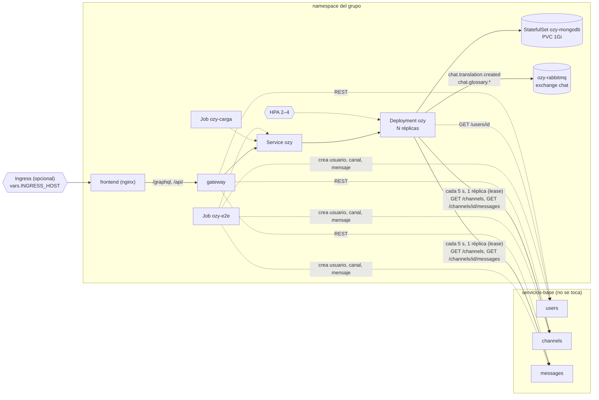

# Ozy en Kubernetes

Despliegue de Ozy en el clúster común del curso, **junto al chat base ya
desplegado y sin modificarlo**. Ozy vive en el namespace del grupo, trae su propia
MongoDB y solo se conecta al core por sus APIs públicas.

En el mismo namespace y con el mismo pipeline se despliegan también el
**API Gateway** (`demo/gateway`, GraphQL + REST) y la **interfaz web**
(`demo/frontend`, React servido por nginx). Ver
[Gateway e interfaz web](#gateway-e-interfaz-web).

En el clúster del curso, el chat base (`servicios-base`) **no tiene broker**: su
`messages` no publica `chat.message.created`. Por eso:

- **Entrada (mensajes):** Ozy usa su **sincronizador**. Cada 5 s, una sola réplica
  (la que tiene el _lease_ en MongoDB) lee `GET /channels` y
  `GET /channels/{id}/messages` y copia los mensajes nuevos a su read-model por la
  capa anticorrupción. `POST …/translation?channel_id=` sincroniza ese canal al
  momento.
- **Salida (eventos propios):** Ozy publica `chat.translation.created` y
  `chat.glossary.*` en el exchange `chat` de **su propio RabbitMQ** (`ozy-rabbitmq`,
  en el namespace del grupo), como hacen otros grupos.



## Contenido

| Ruta                                                                               | Qué es                                                                                                                                                       |
| ---------------------------------------------------------------------------------- | ------------------------------------------------------------------------------------------------------------------------------------------------------------ |
| `base/`                                                                            | Deployment (probes, recursos, seguridad), Service, HPA, PDB, ConfigMap, MongoDB propia (StatefulSet) y RabbitMQ propio (Deployment), ambos con NetworkPolicy. El overlay `curso` quita el PDB y las NetworkPolicies (ver abajo) |
| `overlays/curso/`                                                                  | Ajustes del clúster del curso: namespace, imagen y direcciones del core (`core.env`, **no versionado**; plantilla en `core.env.example`)                     |
| `pruebas/`                                                                         | Jobs de evidencia: `ozy-e2e` (flujo integrado) y `ozy-carga` (carga para el HPA)                                                                             |
| `evidencia/`                                                                       | Scripts que lanzan los Jobs y guardan la evidencia en `evidencia/salida/`                                                                                    |
| [`../../../.github/workflows/ozy-k8s.yml`](../../../.github/workflows/ozy-k8s.yml) | CI/CD: tests → imagen en GHCR → deploy → prueba integrada                                                                                                    |

## Probes

| Probe     | Ruta            | Qué comprueba                                                        | Por qué así                                                                                                                                                                                         |
| --------- | --------------- | -------------------------------------------------------------------- | --------------------------------------------------------------------------------------------------------------------------------------------------------------------------------------------------- |
| startup   | `/health/live`  | Que la app terminó de arrancar (índices + glosario)                  | Ozy espera hasta 60 s a su MongoDB al arrancar; sin startupProbe, la liveness lo mataría a mitad del arranque                                                                                       |
| liveness  | `/health/live`  | Proceso vivo **y hilo de ingesta vivo** (sincronizador o consumidor) | No mira MongoDB, RabbitMQ ni el chat base: reiniciar Ozy no arregla una dependencia caída. Pero si el hilo de ingesta muere, Ozy dejaría de recibir mensajes en silencio y reiniciar sí lo recupera |
| readiness | `/health/ready` | Ping a su MongoDB (informa también `ingestion: api`)                 | Sin base no puede atender; se saca del Service. RabbitMQ no se exige porque sin broker la API sigue funcionando (degradación elegante)                                                              |

`ozy-mongodb` y `ozy-rabbitmq` tienen sus propias probes (ping de `mongosh` y
socket AMQP, con _startup_ para el arranque lento de Erlang).

Todas las respuestas llevan la cabecera `X-Ozy-Instance` con el nombre del pod:
así se ve en la evidencia qué réplica atendió cada petición.

## Autoscaling

`HorizontalPodAutoscaler` sobre CPU (requiere metrics-server, presente en casi
todos los clústeres gestionados y en k3s):

| Parámetro | Valor                                | Motivo                                                                                                      |
| --------- | ------------------------------------ | ----------------------------------------------------------------------------------------------------------- |
| Réplicas  | mín. 2, máx. 4                       | 2 para tolerar la caída de un pod (el PDB `minAvailable: 1` solo se aplica fuera del clúster del curso); 4 es lo que cabe en la cuota junto al broker |
| Objetivo  | 60 % de `requests.cpu` (50m)         | Escala antes de saturar el límite de 200m                                                                   |
| Subida    | hasta +2 pods cada 30 s, sin ventana | Reacciona rápido a un pico                                                                                  |
| Bajada    | −1 pod cada 30 s tras 120 s estable  | Evita oscilaciones y deja ver la bajada en la prueba                                                        |

### Cuota del namespace

El grupo tiene una `ResourceQuota` (limits 2 CPU / 2Gi, requests 1 CPU / 1Gi, 10 pods,
1 PVC de 1Gi) y un `LimitRange` (máx. 1 CPU / 1Gi por contenedor). Todo está
dimensionado para caber **en el peor caso**, con la carga corriendo:

| Componente      | Pods       | requests (CPU / mem)        | limits (CPU / mem)            |
| --------------- | ---------- | --------------------------- | ----------------------------- |
| Ozy al máximo   | 4          | 200m / 384Mi                | 800m / 768Mi                  |
| MongoDB propia  | 1          | 100m / 192Mi                | 250m / 448Mi                  |
| RabbitMQ propio | 1          | 100m / 128Mi                | 250m / 320Mi                  |
| API Gateway     | 1          | 50m / 96Mi                  | 200m / 192Mi                  |
| Interfaz web    | 1          | 25m / 32Mi                  | 100m / 64Mi                   |
| Job de carga    | 1          | 50m / 64Mi                  | 200m / 96Mi                   |
| **Total**       | **9 / 10** | **525m / 896Mi** de 1 / 1Gi | **1800m / 1888Mi** de 2 / 2Gi |

Con el gateway y la interfaz en el namespace, el Job de carga usa **un** generador
(24 hilos) en vez de dos: basta para llevar Ozy a 4 réplicas y deja un pod libre.

RabbitMQ no usa volumen: la cuota permite un solo PVC (es de MongoDB) y el registro
durable de los eventos ya está en MongoDB (`published_events`).

Consultar el uso: `kubectl describe resourcequota`.

El Deployment **no fija `replicas`**: si lo hiciera, cada `kubectl apply` del CI
pisaría la escala elegida por el HPA.

Escalar varias réplicas es seguro porque Ozy ya era _stateless_ en la API:

- todas las réplicas comparten la misma MongoDB propia;
- sin broker, solo una réplica sincroniza a la vez (lease en MongoDB) y el upsert
  del read-model es idempotente; con broker, la cola durable reparte los mensajes
  entre réplicas (consumidores en competencia);
- índices y glosario inicial son idempotentes, así que varias réplicas arrancando
  a la vez no duplican nada.

- los eventos emitidos se guardan en la base propia (`published_events`), así que
  `GET /api/v1/events` responde lo mismo desde cualquier réplica.

### Permisos del clúster del curso

El rol del grupo no puede crear `PodDisruptionBudget` ni `NetworkPolicy`
(`kubectl auth can-i --list`), así que el overlay `curso` los quita con
`$patch: delete`. La base los conserva para un clúster propio. La NetworkPolicy
del curso `conexiones-del-grupo` admite tráfico de entrada del mismo namespace,
de `infraestructura`, de las APIs de `servicios-base` y **de cualquier namespace
con la etiqueta `inf326.usm.cl/tenant=student`, en todos los puertos**. Es decir,
otros grupos sí pueden llegar a la MongoDB y al RabbitMQ de Ozy: ese aislamiento
no existe entre estudiantes (la salida de los pods está limitada de forma
parecida). Ver «Riesgo conocido» más abajo.

El namespace exige PodSecurity `baseline` y avisa con `restricted`: los cuatro
contenedores (Ozy, MongoDB, RabbitMQ y los Jobs) corren sin root y sin
capabilities, así que cumplen `restricted` sin avisos.

### Riesgo conocido: MongoDB sin autenticación

Según la política `conexiones-del-grupo` (salida de `kubectl describe networkpolicy
-n grupo-ozy`), cualquier pod de un namespace con la etiqueta
`inf326.usm.cl/tenant=student` puede conectarse a cualquier puerto de los pods de
`grupo-ozy`. La MongoDB de Ozy (`ozy-mongodb:27017`) corre sin autenticación, así que
otro grupo que conozca el nombre del Service podría leer o modificar el glosario, las
traducciones y la copia de mensajes. El broker propio sí exige usuario y clave
(`ozy-secrets`).

No se pudo cerrar con una NetworkPolicy propia (el rol del grupo no puede crearla, ver
arriba). La mitigación posible es activar la autenticación de MongoDB (usuario y clave
en `ozy-secrets` y en `MONGODB_URL`), pero cambia el despliegue del StatefulSet y la
conexión de Ozy, por lo que se dejó documentada y sin aplicar. No se probó el acceso
desde otro namespace: es lo que se deduce de la política.

## Puesta en marcha (una vez)

1. **Datos del curso.** Kubeconfig con el namespace del grupo por defecto y las
   URLs internas de `users`, `channels` y `messages`. El broker es propio: solo
   hay que inventar su clave.
2. **Secrets y variables del repo** (Settings → Secrets and variables → Actions).
   Las URLs del core van como _secrets_ para que **no queden en el repo** ni se
   vean en los logs:

   | Tipo     | Nombre                  | Valor                                                                                               |
   | -------- | ----------------------- | --------------------------------------------------------------------------------------------------- |
   | Secret   | `KUBECONFIG`            | kubeconfig en base64 (`base64 -w0 <archivo>`) o en texto. Nunca se copia al repo                    |
   | Secret   | `OZY_USERS_URL`         | URL interna de `users` (entregada por el curso)                                                     |
   | Secret   | `OZY_CHANNELS_URL`      | URL interna de `channels`                                                                           |
   | Secret   | `OZY_MESSAGES_URL`      | URL interna de `messages`                                                                           |
   | Secret   | `OZY_RABBITMQ_PASSWORD` | clave del RabbitMQ propio: inventarla (larga, al azar). El CI arma con ella el Secret `ozy-secrets` |
   | Variable | `OZY_NAMESPACE`         | opcional: namespace del grupo. Si no se define, se usa el que trae el kubeconfig |
   | Variable | `CORE_NAMESPACE`        | opcional: namespace del chat base (por defecto `servicios-base`), para la evidencia |

   Opcionales (gateway e interfaz):

   | Tipo     | Nombre               | Valor                                                                                      |
   | -------- | -------------------- | ------------------------------------------------------------------------------------------ |
   | Secret   | `OZY_SEARCH_URL`     | Service de búsqueda de otro grupo, directo: `http://search.<namespace>:8000`                |
   | Secret   | `OZY_SEARCH_HOST`    | no se usa con la conexión directa; solo si hubiera que pasar por un Ingress                 |
   | Secret   | `OZY_SUMMARIES_URL`  | Service de resúmenes de otro grupo, directo: `http://summaries.<namespace>` (puerto 80)     |
   | Variable | `INGRESS_HOST`       | host público de la interfaz. Sin él no se crea Ingress (se usa `port-forward`)              |
   | Variable | `INGRESS_CLASS`      | IngressClass del clúster (por defecto `traefik`)                                            |

3. **Imágenes públicas.** Tras el primer push a `main`, en GitHub → Packages,
   cambiar a _Public_ los paquetes `ozy`, `ozy-gateway` y `ozy-frontend` (Package
   settings → Change visibility) para que el clúster pueda descargarlos sin
   credenciales. (Alternativa: un `imagePullSecret` referenciado en los Deployments.)

## Integración continua

El despliegue se hace **solo por GitHub Actions**. Ozy no tiene URL pública: su
Service es `ClusterIP` y las pruebas corren como Jobs dentro del clúster. Lo único
expuesto hacia afuera es la interfaz web, y solo si se define `vars.INGRESS_HOST`.

Cada push a `main` o `github-actions` que toque `demo/ozy/**`, `demo/gateway/**` o
`demo/frontend/**` ejecuta
[`ozy-k8s.yml`](../../../.github/workflows/ozy-k8s.yml):

1. **test** — 74 tests de Ozy y 23 del gateway con pytest, compilación de la
   interfaz (`npm run build`) y render de los manifiestos con kustomize.
2. **image** — construye y publica 3 imágenes, `ghcr.io/<owner>/{ozy,ozy-gateway,ozy-frontend}`,
   con tag `<sha>` y `:latest`.
3. **deploy** — fija namespace e imagen `<sha>`, arma `core.env` desde los
   secrets (solo en el runner, sin imprimirlo); crea/actualiza el
   Secret `ozy-secrets` (usuario/clave del broker y `RABBITMQ_URL`);
   `kubectl apply -k overlays/curso`; espera el rollout de MongoDB, RabbitMQ, Ozy,
   gateway e interfaz; si hay `vars.INGRESS_HOST`, aplica el Ingress
   (`maxUnavailable: 0`, así que nunca baja la capacidad durante un deploy) y
   comprueba que el HPA reciba métricas de CPU (si no, falla: falta metrics-server).
4. **prueba integrada** — corre `evidencia/flujo-integrado.sh`; si falla, el
   workflow queda en rojo. La salida queda como _artifact_ `evidencia-ozy-<n>`.
5. **escalamiento** (opcional) — _Run workflow_ con `escalamiento = true`.

En pull requests solo corre `test`.

## Gateway e interfaz web

| Componente | Manifiestos            | Imagen           | Probes                                                  |
| ---------- | ---------------------- | ---------------- | ------------------------------------------------------- |
| `gateway`  | `demo/gateway/k8s/`    | `ozy-gateway`    | startup, liveness y readiness en `/health`              |
| `frontend` | `demo/frontend/k8s/`   | `ozy-frontend`   | liveness y readiness en `/healthz` (lo responde nginx)  |

- El overlay `curso` los incluye, así que se despliegan junto a Ozy con un solo
  `kubectl apply -k`. Cada uno tiene 1 réplica: el HPA es de Ozy, la capacidad
  evaluada.
- El navegador solo habla con nginx: `/graphql` y `/api/` se reenvían al Service
  `gateway`, así que no hace falta CORS ni exponer el gateway aparte.
- El gateway usa el mismo ConfigMap `ozy-config` que arma el CI desde secrets, así
  que las URLs del core (y de búsqueda/resúmenes) tampoco quedan en el repo.
- Ambas imágenes corren sin root (el namespace aplica PodSecurity *restricted*): el
  gateway con el usuario 10001 y la interfaz con `nginx-unprivileged` en el puerto 8080.

**Acceso.** Desde el navegador se llega por el **Ingress** (definir
`vars.INGRESS_HOST` y, si no es Traefik, `vars.INGRESS_CLASS`). Entre namespaces de
estudiantes se llama directo al Service (la política del curso lo permite); un pod
de `grupo-ozy` no llega a Traefik (`infraestructura`) ni a la IP pública del
balanceador: ambos expiran. Mientras no haya Ingress:

```bash
kubectl port-forward service/frontend 3000:8080    # interfaz en http://localhost:3000
kubectl port-forward service/gateway 8080:8000     # GraphiQL en http://localhost:8080/graphql
```

## Conexión con los servicios de otros grupos

El gateway usa dos capacidades desplegadas por otros grupos en el mismo clúster.
Se llaman **directo a su Service**, por DNS interno:

| Capacidad | Namespace | Service | Puerto | Secret de GitHub |
| --- | --- | --- | --- | --- |
| Búsqueda | `grupo-busqueda-avanzada` | `search` | 8000 | `OZY_SEARCH_URL=http://search.grupo-busqueda-avanzada:8000` |
| Resúmenes | `grupo-resumenes` | `summaries` | 80 | `OZY_SUMMARIES_URL=http://summaries.grupo-resumenes` |

- Los valores van **sin comillas, sin barra final y sin `/api/v1`**: el gateway agrega
  la ruta.
- **No** se define `OZY_SEARCH_HOST`: con un valor, el gateway mandaría un `Host` de
  Ingress que el Service no espera.
- El CI copia estos secrets al ConfigMap `ozy-config` en cada deploy. Cada deploy cambia
  la imagen del gateway (etiqueta = SHA), así que el gateway se reinicia y los toma.
  Un secret nuevo solo se aplica en el siguiente push a `main`.
- Si falta un secret, el gateway sigue funcionando y esa sección de la interfaz
  aparece como servicio caído.

**Por qué directo y no por Ingress.** La NetworkPolicy `conexiones-del-grupo`
(`kubectl describe networkpolicy -n grupo-ozy`) deja salir a cualquier namespace con
la etiqueta `inf326.usm.cl/tenant=student`, en todos los puertos, pero no a
`infraestructura` (Traefik) ni a IPs privadas. Desde el gateway se probó:

| Destino | Resultado |
| --- | --- |
| `http://search.grupo-busqueda-avanzada:8000/health` | `{"status":"ok"}` |
| `http://summaries.grupo-resumenes/health` | `{"status":"ok"}` |
| `http://traefik.infraestructura/health` con `Host` de cada grupo | timeout |
| `http://resumenes.134.199.176.3.nip.io/health` (IP pública) | timeout |

Los Ingress de esos grupos sirven para el navegador, no para llamadas entre pods.

### Verificar la conexión

Los nombres y puertos de los Services se consultan con:

```bash
kubectl get svc -n grupo-busqueda-avanzada
kubectl get svc -n grupo-resumenes
```

Prueba desde el gateway desplegado. No crea pods ni consume cuota:

```bash
kubectl exec -n grupo-ozy deploy/gateway -- python -c "import urllib.request as u;print(u.urlopen('http://search.grupo-busqueda-avanzada:8000/health',timeout=5).read())"
kubectl exec -n grupo-ozy deploy/gateway -- python -c "import urllib.request as u;print(u.urlopen('http://summaries.grupo-resumenes/health',timeout=5).read())"
```

> Al copiar estos comandos, revisar que no aparezcan `%7B`/`%7D` en lugar de llaves;
> por eso no usan `{}`.

Tras el deploy, en GraphiQL (`/graphql`) la query `{ health { service status } }`
debe mostrar `ok` en `users`, `channels`, `messages`, `ozy`, `search` y `summaries`.

| Resultado | Significado | Qué hacer |
| --- | --- | --- |
| `{"status":"ok"}` | Conecta | Nada |
| `timeout` | La red bloquea ese destino | No usar Ingress ni IP pública; usar el Service directo |
| Error de DNS (`Name or service not known`) | El Service o el namespace no se llama así | `kubectl get svc -n <namespace>` y corregir el secret |
| `search`/`summaries` en `down` en `health` | Falta el secret o no se redesplegó | Crear el secret y volver a desplegar `main` |
| Resumen en `fallida` | Error del otro servicio (por ejemplo, cuota de Gemini) | Leer el campo `error`; no se arregla desde Ozy |

Búsqueda tiene consistencia eventual: un mensaje nuevo aparece tras unos 5–12 s.
Además, su índice contiene los mensajes de **todo** el chat compartido, no solo los
del grupo.

## Despliegue manual

No se usa: todo despliegue pasa por el workflow, para que el clúster refleje
siempre un commit del repo. Para redesplegar sin cambios de código: GitHub →
Actions → `ozy-k8s` → _Run workflow_.

## Evidencia

Desde la raíz del repo, con `kubectl` apuntando al clúster del curso:

```bash
# 1. Flujo integrado contra el chat base desplegado
NS=<ns> CORE_NS=<core> demo/ozy/k8s/evidencia/flujo-integrado.sh

# 2. Escalamiento (≈ 5 min de carga + 5 min de observación de la bajada)
NS=<ns> demo/ozy/k8s/evidencia/escalamiento.sh
```

| Script               | Qué demuestra                                                                                                                                                                                                       | Archivos en `evidencia/salida/<fecha>-*/`                                                  |
| -------------------- | ------------------------------------------------------------------------------------------------------------------------------------------------------------------------------------------------------------------- | ------------------------------------------------------------------------------------------ |
| `flujo-integrado.sh` | Usuario, canal y mensaje creados en el **core real** → Ozy lo lee desde la API de `messages` → traduce, detecta candidato, valida → sus 3 eventos llegan al exchange `chat` de su broker; qué réplicas respondieron | `00-estado.txt`, `01-e2e.log`, `02-ozy.log`, `resumen.txt`                                 |
| `escalamiento.sh`    | 2 generadores × 16 hilos sobre el glosario de Ozy; el HPA sube réplicas (hasta 4), la carga se reparte entre ellas y, al terminar, vuelve a 2                                                                       | `00-inicial.txt`, `serie.csv`, `01-watch.log`, `02-carga.log`, `03-hpa.txt`, `resumen.txt` |

Ninguna salida incluye las URLs internas del core (el e2e muestra solo rutas).

La carga **solo lee el glosario de Ozy**: no crea datos en el core ni le pide
nada, para no afectar a los demás grupos que usan el mismo chat base.

Capturas recomendadas para el informe: `resumen.txt` de ambas pruebas, el bloque
_Events_ de `03-hpa.txt` (`SuccessfulRescale … New size: N`) y un gráfico de
`serie.csv` (réplicas y CPU en el tiempo).

## Problemas frecuentes

| Síntoma                                           | Causa                                                   | Qué hacer                                                                                                                                   |
| ------------------------------------------------- | ------------------------------------------------------- | ------------------------------------------------------------------------------------------------------------------------------------------- |
| `ImagePullBackOff` en `ozy`                       | Paquete de GHCR privado                                 | Hacerlo público o agregar `imagePullSecrets`                                                                                                |
| HPA con `cpu: <unknown>`                          | Falta metrics-server o `requests.cpu`                   | `kubectl top pods`; pedir metrics-server al curso                                                                                           |
| Pods `0/1` y reinicios al arrancar                | MongoDB propia aún no está lista                        | Normal los primeros segundos; si persiste, `kubectl describe pod ozy-mongodb-0` (PVC/StorageClass)                                          |
| Pod sin crearse, evento `exceeded quota`          | Se superó la cuota del namespace                        | `kubectl describe resourcequota`; bajar `maxReplicas` o pedir más cuota al ayudante                                                         |
| e2e falla en «Ozy recibió el mensaje»             | Ozy no llega a channels/messages                        | `kubectl logs deploy/ozy`: buscar `Message sync failed (…)`; revisar los secrets `OZY_CHANNELS_URL` y `OZY_MESSAGES_URL`                    |
| e2e falla en «el broker acepta conexiones»        | `ozy-rabbitmq` no está listo o la clave no coincide     | `kubectl logs deploy/ozy-rabbitmq`; si cambiaste `OZY_RABBITMQ_PASSWORD`, reinicia el broker: `kubectl rollout restart deploy/ozy-rabbitmq` |
| Log `Syncing messages…` pero nunca `Synced N new` | Ninguna réplica toma el lease, o no hay mensajes nuevos | `kubectl exec` a un pod y `curl localhost:8000/health/ready` (`ingestion: api`)                                                             |
